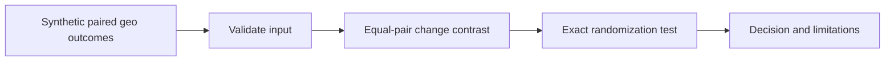

> **Proprietary - All Rights Reserved.** Licensed to Sandeep Grover. No reuse, copying, modification, or distribution without prior written permission. See LICENSE.

# Brand lift measurement design demo

Synthetic paired randomized geography example: separating a common market trend from incremental search outcomes. This is an original methodological illustration, not client work or evidence of deployed advertising measurement.



## Run
Python 3.11+, no dependencies:
```bash
python main.py
python -m unittest -v
```
Output: `synthetic_data.json` and `results.json`. Tests are available for inspection; execution/reuse permissions are governed by LICENSE.

## What the result means
Twelve hypothetical independent geographic pairs each contain one randomized treatment and one control. Equal-length pre/post periods count branded search outcomes. The treated-only increase is 29 counts per geography; the control increase is 20; the equal-pair difference in changes is 9. The exact two-sided test enumerates all 4,096 sign assignments and evaluates the sharp null of no effect in any geography.

The estimand is an equal-pair mean change contrast in counts, not population-weighted national lift, return on spend, a relative percentage, or awareness lift. Do not interpret the p-value as probability of a campaign effect, and do not infer a precise effect size from significance. No uncertainty interval is reported; an actual engagement would prespecify interval construction, baseline adjustment, power, minimum detectable effect, and multiplicity handling.

## Assumptions and boundaries
Within-pair assignment must actually be randomized with equal independent probabilities; geography boundaries, outcomes and analysis window must be specified before outcomes are inspected. Spillover, concurrent campaigns, outcome tracking changes and budget interference require assessment. Arbitrary observational pairs do not justify this randomization test. Pure pre/post association is not proof of incrementality. The fixture is constructed to illustrate a concept and is not a realistic power simulation or market forecast.

Brand awareness and message association require separate, appropriately sampled exposed/control survey designs; search counts are not substitutes. Attribution allocates credit under a specified model; it does not by itself estimate causal impact. Marketing mix modeling requires sufficiently long, variable, reliable data and sensitivity assessment; no universal accuracy promise is made.

## Method references
- Google Research, Vaver and Koehler, Measuring Ad Effectiveness Using Geo Experiments (2011): https://research.google/pubs/measuring-ad-effectiveness-using-geo-experiments/
- Google Research, Chen and Au, Robust Causal Inference for Incremental Return on Ad Spend with Randomized Paired Geo Experiments (2022): https://research.google/pubs/robust-causal-inference-for-incremental-return-on-ad-spend-with-randomized-paired-geo-experiments/
The code is a simple exact sign-flip illustration, not an implementation of Google's matched-markets product or the Trimmed Match estimator.
